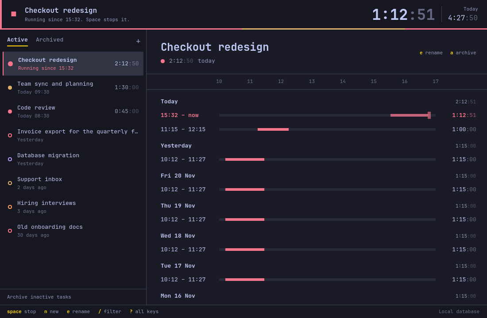

# tt-desktop: Time Tracker for Omarchy



`tt-desktop` is the Omarchy desktop app for Time Tracker. It shows your tasks, the running timer, today's totals and each task's worklogs on a timeline, and edits tasks and worklogs. It follows the current Omarchy theme while it runs, and every action has a key.

The Omarchy bar widget stays the status indicator and pauses tracking when the screen locks. `tt-desktop` has no tray icon. Closing it leaves a running timer running.

## Build and run

You need Omarchy (or Arch Linux with Hyprland), Rust 1.88 or newer, and Qt 6 (`qt6-base`, `qt6-declarative` and `qt6-wayland`).

```sh
apps/omarchy/bin/build           # debug build into apps/omarchy/build/tt-desktop
apps/omarchy/bin/build release   # release build
apps/omarchy/bin/test            # Qt Test unit tests, offscreen
```

To install the current checkout as an Arch package, so it shows up in the app launcher, run `python3 scripts/install-omarchy-app.py` from the repository root.

## Data source

By default the app opens the local database that the terminal client uses too. In Settings (`,`), choose Server and enter the full HTTP or HTTPS origin with its port, for example `http://<server-tailscale-ip>:<port>`. Test connection checks it, and Connect switches to it and saves the choice. A failed connection keeps the previous source. A server never falls back to the local database, and switching never copies data.

The settings live in `~/.config/tt-desktop/tt-desktop.conf`.

## Keys

| Key | Action |
| --- | --- |
| `j` `k` or `↓` `↑` | Select the next or previous task, or worklog in the worklog pane |
| `l` `→` / `h` `←` | Move to the worklogs / back to the tasks |
| `Tab` | Switch between Active and Archived |
| `Space` or `Return` | Start the selected task, or stop it while it runs |
| `s` | Stop tracking |
| `/` | Filter tasks; `Escape` clears the filter |
| `n` | New task |
| `e` | Rename the selected task |
| `a` | Archive or unarchive the selected task |
| `A` | Archive inactive tasks |
| `t` | Edit the selected worklog's times |
| `m` | Move the selected worklog to another task |
| `d` | Delete the selected worklog |
| `r` | Reload |
| `,` | Settings |
| `?` | Show every key |
| `q` or `Ctrl+Q` | Quit. Tracking keeps running. |

Right-click a task, a worklog or the tracking strip for the same actions. Double-click a task to start it, or a worklog to edit its times.

## How it's built

The app is C++ and Qt Quick, built with qmake6. It links the Rust core through the C ABI of `crates/tracker-bridge`, the same library the macOS app uses. [ADR 0042](../../docs/architecture/adr/0042-build-the-omarchy-client-with-qt-quick-on-the-shared-c-bridge.md) explains the choice.

- `src/Bridge/RustTrackerGateway` runs every bridge call on one worker thread and answers on the GUI thread.
- `src/Features/<Feature>/` holds each feature's C++ store and its QML views. Stores depend on `src/Contracts/TrackerGateway.h`, so tests script the replies with `tests/FakeTrackerGateway.h`.
- `src/App/` holds the window and the views that combine several features: the sidebar, its task rows, the tracking strip and the status line.
- `src/App/TrackerSync` reads tasks, tracking and today's totals after connecting, after every write, at midnight and every 30 seconds.
- `src/Shared/Tokens.qml` holds the font sizes, spacing, opacities and fixed sizes the views use. `bin/lint` rejects number literals for font sizes, spacing, padding, margins, radii and opacities anywhere else. A new QML file in `src/Shared/` also needs a line in `src/Shared/qmldir`.
- `src/Shared/Theme` reads `~/.local/state/omarchy/current/theme/colors.toml` and reloads it when the theme changes. It reads Hyprland's `decoration:rounding` once at startup.
