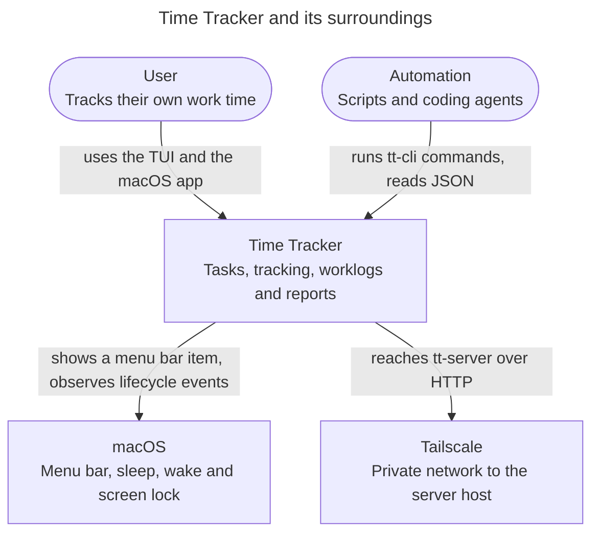
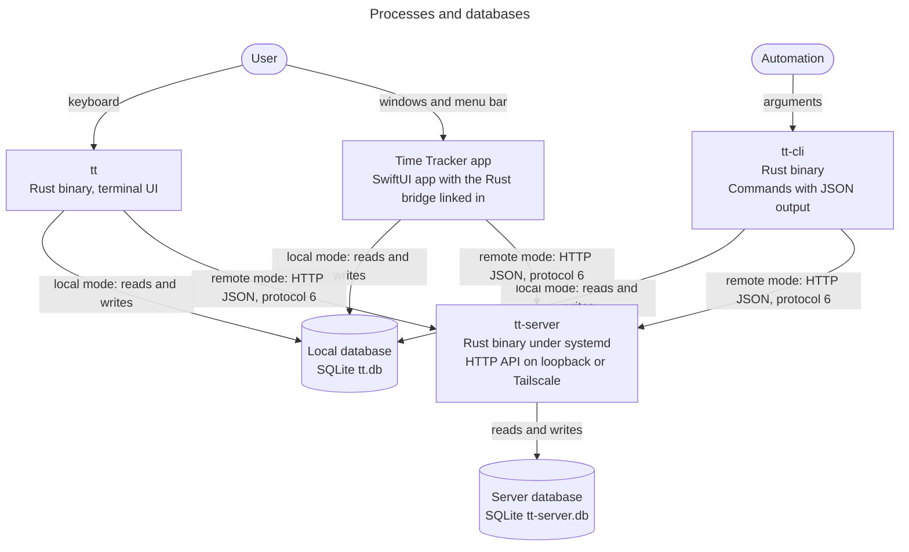
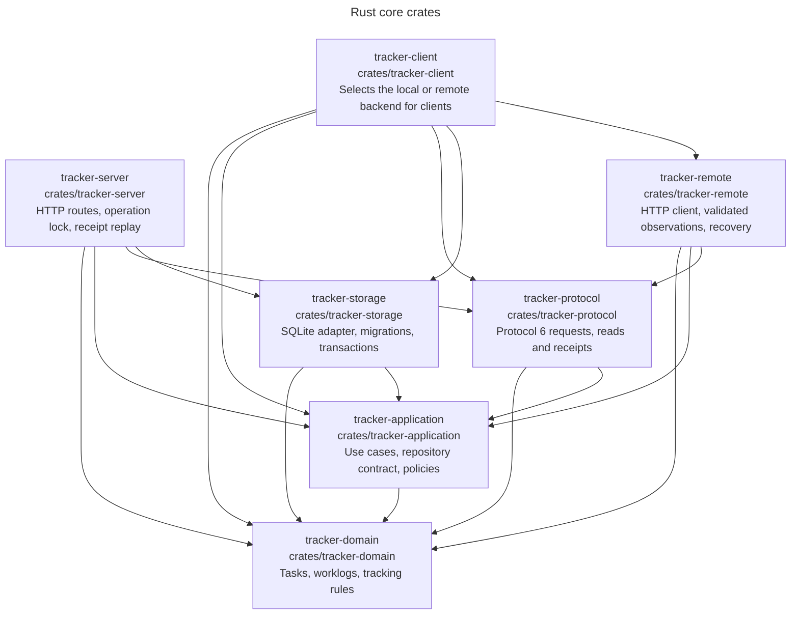
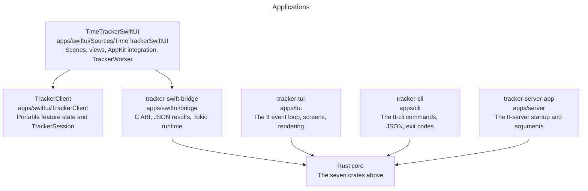
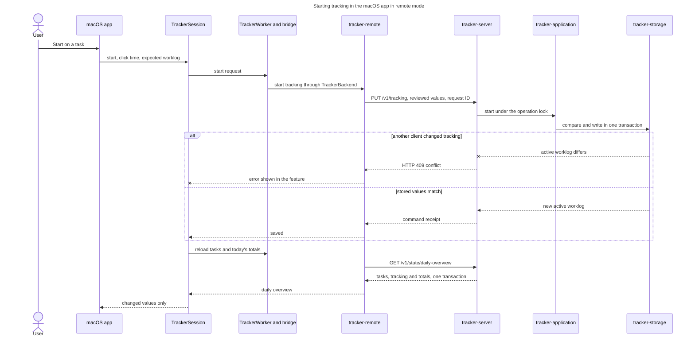
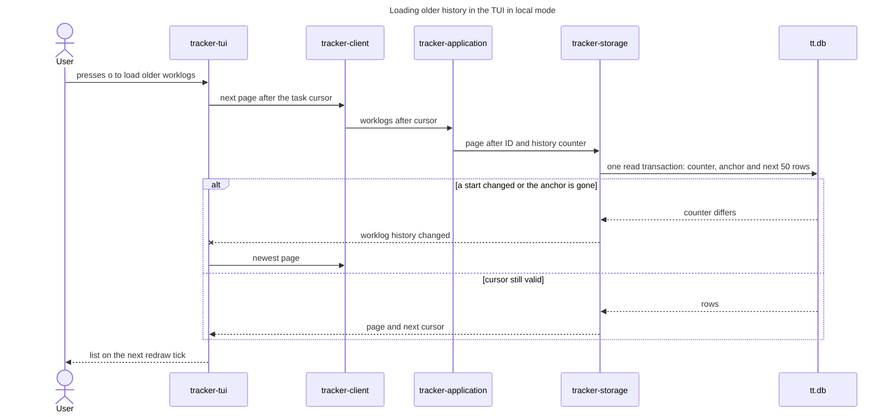

# Time Tracker architecture

Time Tracker shares one Rust core across a terminal UI, an automation CLI and a
native macOS app. Each client either opens a local SQLite database or sends the
same actions to `tt-server`, which owns its own SQLite database. Domain rules and
persistence live in Rust; clients own presentation, input and scheduling
([ADR 0021](adr/0021-share-concrete-client-backend.md),
[ADR 0028](adr/0028-ship-a-standalone-server-binary.md)). Method-level diagrams
of the clients and the Swift-to-Rust bridge are in [diagrams.html](diagrams.html).

## Domain language

- **Task**: a reusable activity with a validated name, an archive flag and
  creation and update timestamps. Archiving keeps its worklogs. Owner:
  [task model](../../crates/tracker-domain/src/task.rs)
  ([ADR 0002](adr/0002-task-timestamps-and-ordering.md),
  [ADR 0009](adr/0009-task-search.md)).
- **Worklog**: a recorded interval owned by one task; without an end it is
  active. Intervals include their start and exclude their end, must have a
  positive duration and can't overlap within one task. Owner:
  [worklog model](../../crates/tracker-domain/src/worklog.rs)
  ([ADR 0005](adr/0005-worklog-correction.md),
  [ADR 0007](adr/0007-completed-worklog-deletion.md),
  [ADR 0008](adr/0008-move-worklogs-between-tasks.md)).
- **Active tracking**: the tracker is idle or runs one worklog across the
  database. Switching stops the old worklog and starts the new one atomically;
  closing a client leaves tracking running. Owner:
  [tracking model](../../crates/tracker-domain/src/tracking.rs).
- **Operation instant**: the time a client supplies for an action. The
  application canonicalizes it to UTC microseconds; calendar boundaries use time
  zone rules ([ADR 0003](adr/0003-canonical-timestamp-precision.md),
  [ADR 0006](adr/0006-local-minute-tui-timestamps.md)).
- **History page**: up to 50 worklogs, newest start first, continued with a
  cursor holding the last ID and a database counter
  ([ADR 0004](adr/0004-paginated-worklog-history.md),
  [ADR 0024](adr/0024-id-only-worklog-cursors-and-positive-durations.md)).
- **Report**: task totals for an interval. Running work is clipped at an explicit
  cutoff and archived tasks stay included. Owner:
  [report use cases](../../crates/tracker-application/src/service/reports.rs).
- **Inactive-task archive preview**: the tasks without creation, change or work
  within a period, 14 days by default, captured at a fixed time. Confirmation
  rechecks eligibility in one transaction
  ([ADR 0016](adr/0016-configurable-inactive-task-archiving.md)).
- **Reviewed values**: the values a user saw before a write, such as a task name
  or the active worklog. Guarded writes carry them, and storage rejects the write
  when the stored values differ
  ([ADR 0023](adr/0023-enforce-reviewed-intent-at-application-boundaries.md)).

## Context

One person uses the application, usually in one window at a time. Several
clients and machines can change the same data, but the design doesn't optimize
for it: rejecting an outdated write and asking for a reload is acceptable.

## Processes

Each client selects its mode at startup: `tt` and `tt-cli` take `--server URL`,
`tt-cli` also takes `--db PATH`, and the macOS app reads its Settings. Remote
failures never fall back to local storage. Local clients can open the same
`tt.db` at the same time; SQLite transactions and triggers keep them consistent.
The macOS app links `tracker-swift-bridge` as a static library and calls it
through a C ABI on one serial worker, so it is one process.
[Deploy a server](../deployment.md) describes how `tt-server` is built and
rolled out.

## Modules and dependencies

Arrows show permitted dependencies. For Rust crates, the Cargo manifests are the
rule: a crate can only use the workspace crates it declares. The `TrackerClient`
Swift package declares no Rust, network or UI dependency.

Which core crates each application may use:

| Application | Rust core crates |
| --- | --- |
| `tracker-tui` | client, application, domain, remote, storage |
| `tracker-cli` | client, application, domain, protocol, remote, storage |
| `tracker-swift-bridge` | client, application, domain, protocol, remote, storage |
| `tracker-server-app` | server, storage |

Inside a crate or app, code is split by feature. Features may depend on other
features but not in a cycle; the compiler doesn't catch cycles between folders,
so review does. In the Swift app and package, only `App/` composes features,
`Shared/` holds helpers no feature owns and `Contracts/` holds protocols and wire
models ([ADR 0030](adr/0030-replace-the-session-with-feature-stores.md)).

### Module responsibilities

- [tracker-domain](../../crates/tracker-domain/src/lib.rs): task and worklog
  identities, validated names, interval rules, tracking transitions and
  inactivity periods. No database, network or UI work; operation instants are
  inputs.
- [tracker-application](../../crates/tracker-application/src/service/mod.rs):
  synchronous use cases through one
  [`TrackerRepository`](../../crates/tracker-application/src/repository.rs)
  contract, calendar and search policies, and semantic failures
  ([ADR 0012](adr/0012-share-client-query-and-failure-policies.md),
  [ADR 0022](adr/0022-consolidate-application-and-repository-contracts.md)).
- [tracker-storage](../../crates/tracker-storage/src/sqlite/mod.rs):
  `SqliteRepository` implements the repository contract with database paths,
  [migrations](../../crates/tracker-storage/src/migrate.rs), coherent reads and
  transactional writes. Constraints and triggers also guard direct SQL writes.
- [tracker-protocol](../../crates/tracker-protocol/src/lib.rs): protocol 6 JSON
  requests, resource reads and command receipts, and `parse_worklog_cursor`, the
  one cursor validation rule. No HTTP client, server or database
  ([ADR 0017](adr/0017-separate-http-resources-from-client-refreshes.md),
  [ADR 0031](adr/0031-remove-server-revisions-from-writes-and-reads.md)).
- [tracker-server](../../crates/tracker-server/src/lib.rs): HTTP routes,
  serialized operations, request-ID receipt replay and coherent aggregate reads
  ([ADR 0019](adr/0019-read-coherent-workflow-state.md),
  [ADR 0027](adr/0027-check-reviewed-task-names-on-the-server.md)).
- [tracker-remote](../../crates/tracker-remote/src/application/mod.rs):
  `RemoteApplication` sends reviewed values without reading first, validates
  responses before publishing them and recovers after failed writes
  ([ADR 0018](adr/0018-compose-resource-state-in-client-workflows.md)).
- [tracker-client](../../crates/tracker-client/src/lib.rs): the `TrackerBackend`
  enum, which dispatches task, tracking, history, report and archive operations
  to the local application or `RemoteApplication`.
- [tracker-tui](../../apps/tui/src/app.rs): the `tt` client. One event loop
  handles input, redraw ticks and request completions; a monotonic clock drives
  the elapsed timer
  ([ADR 0011](adr/0011-use-one-tui-event-loop-with-a-fixed-redraw-tick.md)).
- [tracker-cli](../../apps/cli/src/main.rs): the `tt-cli` client. Invalid input
  fails before a backend opens; see the [command reference](../cli.md).
- [tracker-server-app](../../apps/server/src/main.rs): `tt-server` requires an
  explicit loopback or Tailscale bind address and defaults to `tt-server.db`.
- [tracker-swift-bridge](../../apps/swiftui/bridge/src/backend.rs): the
  [C interface](../../apps/swiftui/Sources/CTrackerBridge/include/TrackerBridge.h)
  of the Rust static library. Rename, archive, tracking and worklog writes
  carry the reviewed values. Create (`tt_bridge_create_task_at`), restore
  (`tt_bridge_unarchive_task_at`) and bulk archive
  (`tt_bridge_archive_inactive_tasks_at`) carry none.
- [TrackerClient](../../apps/swiftui/TrackerClient/Sources/TrackerClient/App/TrackerSession.swift):
  feature state and `TrackerSession` behind injected client, clock, scheduler and
  settings interfaces. Each action sends its request right away; each feature
  disables only its own controls while a request runs
  ([ADR 0026](adr/0026-use-swift-observation-for-native-presentation.md),
  [ADR 0029](adr/0029-send-native-requests-directly.md)). Views read the task
  list, tab and selection from the observable `TaskCatalogStore`, the selected
  task's worklogs from `WorklogHistoryStore`, the connection settings and
  status from `ConnectionStore`, the running worklog, tracking error and timer
  text from `TrackingStore`, today's status and task totals from
  `DailyTotalsStore`, and the other session values from `TrackerPresentation`
  ([ADR 0030](adr/0030-replace-the-session-with-feature-stores.md)). The menu
  bar observer reads these stores, the last tracked task from `MenuBarStore`
  and the values that combine features from `TrackerPresentation` through one
  `Observations` loop. `TrackerSync` loads, refreshes and polls the stores,
  runs the display, rollover and menu bar timers and handles visibility, sleep
  and wake. The session creates the stores and passes them in; its tracking,
  auto-pause, connection change and editor flows call `TrackerSync` to reload
  and publish. `WorklogHistoryStore` sends its own page requests and reports
  failures to `TrackerSync`, which records connection failures.
- [TimeTrackerSwiftUI](../../apps/swiftui/Sources/TimeTrackerSwiftUI/App/TimeTrackerApp.swift):
  one tracker window, Settings, the menu bar item and lifecycle handling. The
  serial
  [`TrackerWorker`](../../apps/swiftui/Sources/TimeTrackerSwiftUI/Infrastructure/RustBridge/TrackerWorker.swift)
  keeps bridge calls and decoding off the UI thread and runs them in order.

## Runtime flow

The worker lane covers `TrackerWorker`, the `tt_bridge_start_tracking_if_active_at`
export of `tracker-swift-bridge` and `TrackerBackend` in `tracker-client`. Replies
run back through it; the diagram skips those hops. The reload reads
`/v1/state/task-list` first only while the connection is unconfirmed or stale.
The transport resends a failed write once with the same request ID. If that
also fails, the app reports that the change could not be confirmed and doesn't
resend it.

## Revisions and concurrency

The server keeps no global revision. Guarded writes carry the values the caller reviewed,
and the shared application and storage operations compare them with stored state
in the same transaction as the write. Database counters guard history paging in
local and remote mode.

| Mechanism | Stored in | Protects against |
| --- | --- | --- |
| Reviewed values | The request | A write based on an outdated worklog, active timer or task name |
| Request ID | Server memory, at most 1,024 successful receipts | A resent command running twice while its receipt is cached |
| Per-task history counter | `history_order_revision` on each task | Continuing a task's history after a worklog start changed or a worklog moved |
| Global history counter | One `global_worklog_revision` row | Continuing the all-worklogs history after any worklog write |

**Reviewed values.** Correction compares the original worklog times; move and
deletion also compare the original task. A mismatch returns HTTP 409
`worklog_changed`. Start and switch compare the expected active worklog; stop
rejects a replacement timer and succeeds when no timer remains. Rename and archive
compare `expected_name` when the request carries it. A changed timer or name
returns HTTP 409 `conflict`. Writes to unrelated tasks or worklogs never reject a
command. Create, restore, bulk archive, and rename or archive without
`expected_name` carry no reviewed values; `tt-cli tasks rename` and
`tasks archive` send no expected name and act on the current task.

**Request replay.** `WriteGuard.request_id` identifies a command. Under the
operation lock, an identical cached command returns its receipt with
`replayed: true`; the same ID with a different command returns HTTP 409. A
restart or eviction forgets receipts, so an old command can run again if its
reviewed values still match. This is bounded replay protection, not exactly-once
execution ([ADR 0031](adr/0031-remove-server-revisions-from-writes-and-reads.md)).

**Coherent reads.** `/v1/state/task-list` and `/v1/state/daily-overview` read
tasks, tracking and totals in one SQLite transaction under the operation lock.
Separate task, tracking, history and report reads stay independent.

**History counters.** SQLite triggers update the counters inside the worklog
write, including writes from other local processes. A continuation checks the
counter, resolves its anchor by ID and reads the next rows in one transaction; a
changed counter or missing anchor returns HTTP 409 `worklog_history_changed` and
needs a fresh first page. Renames, archiving, inserts, deletions and end-only
edits leave the task counter unchanged, because existing rows keep their order. The global
counter changes on every worklog write.

The guards coexist because they cover different things: counters cover history
order, reviewed values cover the state a command was reviewed against, and both
also apply to local clients that never reach the server.

## Tests and quality gates

Unit tests sit next to the code. Black-box E2E tests drive the clients and the
HTTP API through their public interfaces. Before handoff, run
`cargo fmt --all --check`, Clippy with warnings as errors, the Python script
tests, `cargo llvm-cov` for the full test suite with coverage and `cargo crap`.
Swift changes also run `scripts/swift-style.py`. Mutation checks with
cargo-mutants and `scripts/swift-mutations.py` cover the files a task changed
([ADR 0014](adr/0014-scope-mutation-checks-to-task-changes.md)).

CI runs formatting, lint and Python tests, Rust tests with coverage and CRAP,
Swift style, tests and coverage on Linux, a focused Swift mutation check on pull
requests, and native macOS UI tests
([ADR 0015](adr/0015-use-github-hosted-runners-for-ci.md),
[ADR 0025](adr/0025-fit-native-ci-within-the-macos-runner-limit.md)). Full Rust
and Swift mutation runs are manual.

## Decisions

The [ADR index](adr/README.md) lists every decision with its status. Follow the
supersession notes when reading older records. Protocol and schema upgrade steps
are in [Deploy a server](../deployment.md#protocol-and-schema-upgrades).
